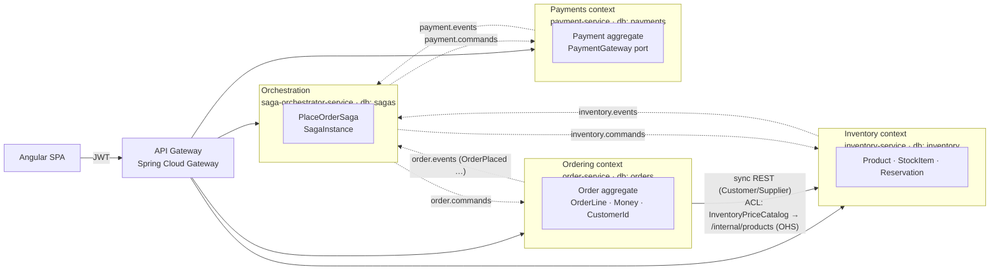

# Context map

Three bounded contexts plus one process manager. Each box owns its own model **and its own database**.
The only code they share is `messaging-contracts` (the Published Language) and the technical helpers in `platform-lib`.

Solid line = synchronous HTTP. Dotted line = asynchronous Kafka message (written through the transactional outbox).

## Relationships

| Upstream → Downstream | Pattern | Where in code |
|---|---|---|
| Inventory → Ordering | **Customer/Supplier** + **Open Host Service** on the Inventory side, **Anti-Corruption Layer** on the Ordering side | `inventory-service/.../interfaces/rest/InternalProductController.java`, `order-service/.../infrastructure/catalog/InventoryPriceCatalog.java` |
| All contexts ↔ Orchestrator | **Published Language** (versionable JSON records with a logical type header) | `messaging-contracts/` |
| Keycloak → everyone | **Conformist**: we take the identity model as-is (`sub` = CustomerId, realm roles) | `platform-lib/.../security/KeycloakJwt.java`, `CurrentUser.java` |

## Same word, different meaning

This is the main reason the contexts are split.

| Concept | Ordering | Inventory | Payments | Orchestrator |
|---|---|---|---|---|
| **Product** | doesn't exist: only `sku` + `productName` + a *price snapshot* on an `OrderLine` | `Product` (catalogue, list price) and `StockItem` (on hand / reserved) | doesn't exist | doesn't exist |
| **Order** | `Order` aggregate with lines, total, status | `Reservation`, keyed by orderId: "units held for some order" | `Payment`, keyed by orderId: "an amount to charge" | `SagaInstance`: progress of one business process |
| **Customer** | `CustomerId` (the Keycloak `sub`) | doesn't exist | `customerId` string, used for the charge | copied from `OrderPlaced` |
| **Money** | `order.domain.Money` (adds, multiplies) | `inventory.domain.Price` | `payment.domain.Money` (must be > 0) | plain `BigDecimal` + currency |

Each context has its own `Money`. A "common Money" class would couple the contexts for very little gain.

## What changed compared with saga-orchestrated-banking-as-service

| Banking project | This project |
|---|---|
| JPA entities shared by every service through `common-lib/entity/*` | Each context has its own model; only message records are shared |
| One MySQL database (`baas_db`) used by all services | One Postgres database per context, each with its own user |
| `ddl-auto: update` | Flyway migrations with `ddl-auto: validate` |
| `StreamBridge.send` straight after the DB write (a dual write) | Transactional outbox plus an idempotent inbox |
| Saga logic spread over step classes | One explicit transition table (`PlaceOrderSaga`), unit-tested without Spring |
