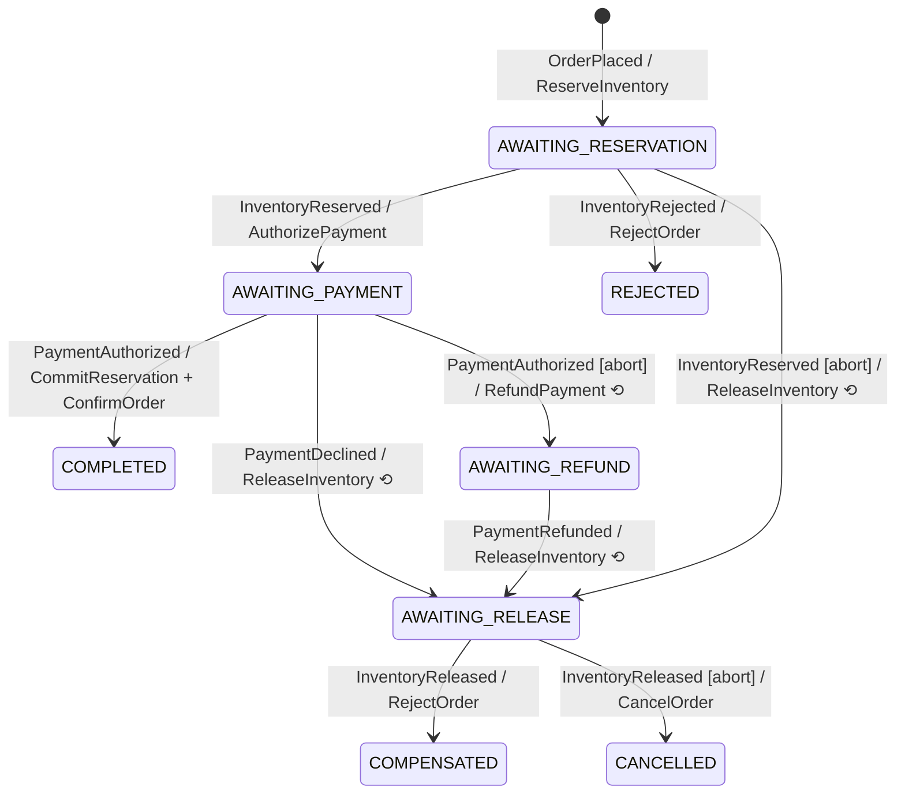
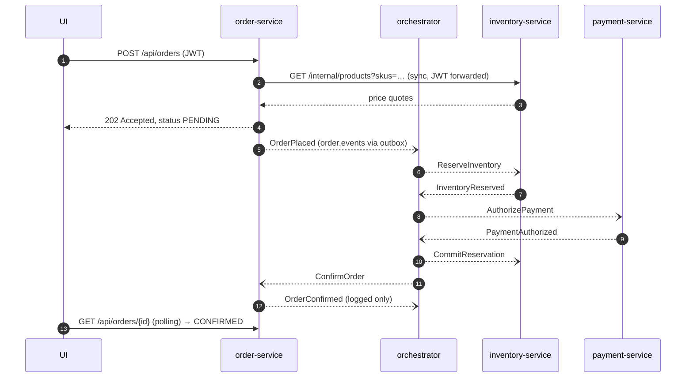

# PlaceOrder saga

The orchestrator (`saga-orchestrator-service`) listens to `order.events`, `inventory.events` and `payment.events`, and sends commands to `*.commands`.
The whole behaviour is in one pure class, `PlaceOrderSaga`, and its unit test `PlaceOrderSagaTest` reads like a specification.

## State machine

⟲ = compensating command. `[abort]` = the customer asked to cancel, or the step timed out (`saga.step-timeout`, 60s by default).

## Happy path, message by message

## Why each design choice

| Problem | Solution here |
|---|---|
| The DB commit succeeds but the Kafka send fails (or the other way round) | **Outbox**: `OutboxPublisher.append` writes the message in the business transaction, and `OutboxRelay` publishes it later. |
| Kafka delivers at least once, so duplicates happen | **Inbox**: `IdempotentMessageHandler` records `messageId` in the same transaction as the handling. Handlers are also *business-idempotent* (a repeated `ReserveInventory` re-announces the existing result). |
| All messages for one order must be processed in order | The Kafka key is always `orderId`, so they share one partition. |
| A compensation arrives for something that never happened | Compensations are safe on missing state. `ReleaseInventory` with no reservation, or `RefundPayment` with no payment, still replies. |
| A poison message would block a partition | `DefaultErrorHandler` retries 3 times, then the message goes to `<topic>-dlt`. |
| Two stock reservations race each other | `@Version` optimistic locking on `stock_item`. The losing transaction rolls back and Kafka retries it. |
| The customer cancels while the saga is running | `OrderCancellationRequested` sets an abort flag. The next reply triggers compensation instead of progress. |

## Known simplifications
- One payment per order, and no partial captures.
- A timeout only *flags* the saga. Compensation runs when the late reply finally arrives. A production system would also send compensations right away and make participants reject late commands.
- A cancel that arrives after the saga reached a final state (for example after `ConfirmOrder` was sent) is ignored and recorded as a note.
- The outbox relay polls every 500 ms. CDC (Debezium) is the production-grade alternative.
